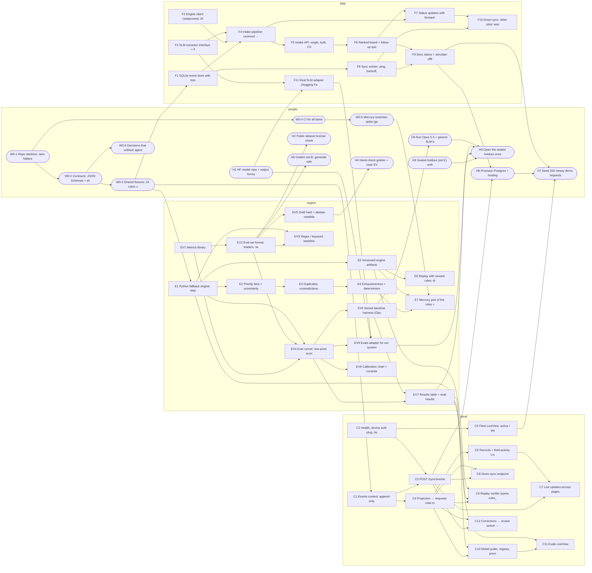

# Implementation plan: Offline Rescue Triage on the night shift

Generated from `tickets.json` (54 tickets) and the rescue-triage plan in `docs/plan/`. Three agent lanes build in parallel overnight; people own the contracts, the labels and the deploys.

## The rules that make this run unattended

1. **Contracts first.** Wave 0 freezes every cross-lane interface (event envelope, SLM output, engine I/O, sync API) plus 24 shared fixture cases. Lanes build against those, never against each other's code, so they can run in parallel.
2. **One lane, one folder.** An agent ticket only touches its lane's folder. Shared files (`contracts/`, `shared/`, `pyproject.toml`, CI) belong to the integrator. Each Python lane has its own `requirements.txt`; the Phoenix cloud owns its `mix.exs`, `mix.lock` and migrations. Agents never edit a shared dependency file.
3. **No external services in tests.** The real HF model, Opus 5.5, Kafka and hosting are behind interfaces with fakes; only Postgres runs in CI (service container). Anything needing accounts, keys or judgment is a human ticket.
4. **Dependencies are explicit.** Every issue carries `Blocked by: #n`. The picker never starts a ticket until those are closed, so Wave 0 issues act as the gate: close them (via the Wave 0 PR) and the lanes start.
5. **Evals labels stay human.** Agents may draft eval cases (`needs_review: true`), but only a person clears them, and the sealed holdout never enters the repo while building. That keeps the evals non-circular (plan `05`, `08`).

## Lanes

| Lane | Folders | Owns (plan workstream) | Token | Overnight tickets |
|---|---|---|---|---|
| `field` | `field/` | A · Field app: FastAPI + HTMX, SQLite + outbox, sync worker, SLM adapter | `CLAUDE_TOKEN_PAAWAN` | 10 |
| `cloud` | `cloud/` | C · Cloud: one Elixir/Phoenix app: sync API + LiveView dashboard, Ecto/Postgres events, replay, model registry | `CLAUDE_TOKEN_DEBU` | 12 |
| `engine` | `engine/ + evals/` | B + D · Decision engine (fallback, then Mercury) and the evals | `CLAUDE_TOKEN_TYLER` | 14 |

Field, engine and evals are Python. The cloud is Elixir/Phoenix: it talks to the field only through the JSON sync contract, and stays in step with the Python side through shared test files in `contracts/examples/` and `contracts/vectors/` that both languages must pass. Workstream E (model training) stays outside the repo, as the plan says; it enters through H1 and C10.

## Phases

Each lane works its queue in wave order (lowest wave first, then issue number), skipping anything blocked.

| Wave | Phase | `field` | `cloud` | `engine` | People | Exit when |
|---|---|---|---|---|---|---|
| W00 | Contracts first (integrator, before agents) | — | — | — | W0-1, W0-2, W0-3, W0-4, W0-5, W0-6 | Every cross-lane interface frozen; CI green; agents switched on |
| W01 | Foundations | F1, F2, F3 | C1, C2 | E1, EV1 | H1, H3 | Each lane has its core module behind the contract: field store/engine client/SLM stub, cloud event store + gateway, fallback engine steps 1–2 + metrics |
| W02 | Core flows | F4, F5 | C3, C4 | E2, EV2, EV5 | H2, H8 | Field pipeline + intake API; cloud accepts sync batches + projection; full rubric tiers; eval set format |
| W03 | Product surfaces | F6, F7, F8 | C5, C6, C7 | E3, EV4 | — | Field board, status, sync worker; cloud fleet/records/SSE; dedupe + eval runner |
| W04 | Integration | F9, F10 | C8 | E5, EV3, EV6, EV7 | H4, H5, H6 | Offline toggle + down-sync; cloud down-sync + replay; baselines + results table |
| W05 | Trust + evals panel | F11 | C9, C10, C11, C12 | E4, EV9, EV8 | — | Model registry + promotion gate + evals panel + corrections; determinism proofs; calibration |
| W06 | Bonus / human gated | — | — | E6, E7 | H9, H7 | Mercury port (if GO), replay diff, demo seeding |

## Lane queues (the order agents will take them)

**`field`**: F1 → F2 → F3 → F4 → F5 → F6 → F7 → F8 → F9 → F10 → F11*

**`cloud`**: C1 → C2 → C3 → C4 → C5 → C6 → C7 → C8 → C9 → C10 → C11 → C12

**`engine`**: E1 → EV1 → E2 → EV2 → EV5 → E3 → EV4 → E5 → EV3 → EV6 → EV7 → E4 → EV9* → EV8 → E6 → E7*

`*` = not night-safe yet (waits on a human decision; see the ticket note).

## Cross-lane dependencies

Only these edges cross a lane or wait on a person; everything else is ordered inside a lane.

| Ticket | Waits on | Why |
|---|---|---|
| F11 | H1 | needs the HF repo + output format |
| C9 | E1 | replay needs the engine CLI |
| C9 | E5 | replay reads the engine manifest |
| C10 | EV7 | promotion gate reads the results format |
| C11 | EV7 | panel renders the results table |
| E7 | W0-5 | only if the Mercury spike is GO |
| EV9 | F11 | uses the field HF extractor |
| EV9 | H1 | needs the HF model |
| H2 | EV2 | converts set A into the eval format |
| H4 | EV5 | checks the drafted cases |
| H5 | EV6 | stored baselines need the harness |
| H8 | EV2 | golden set uses the eval format |
| H9 | EV7 | results table |
| H9 | EV9 | the 'ours' column |
| H6 | C3 | deploy needs sync upload |
| H6 | F9 | deploy needs the offline toggle |
| H7 | H6 | demo runs on the deployed instance |
| H7 | F9 | demo needs the offline toggle |
| H7 | C5 | demo needs the fleet panel |

## Dependency graph



## Critical path and timing

- Lanes run one PR at a time, so **lane length is the clock**: field 10, cloud 12, engine 14 overnight tickets. At 1–2 merged PRs per lane per hour, expect field 5–10 h, cloud 6–12 h, engine 7–14 h. The cloud lane may run slower: Elixir is less familiar to agents than Python.
- Longest dependency chain: **EV1 → EV2 → EV4 → EV6 → EV7 → C10 → C11** (evals into the cloud panel). The engine lane is ordered so EV7 (the results table) is its ticket #11 of 14 and the cloud panel isn't starved.
- Demo-critical by morning: field F1–F9 (offline intake → board → sync), cloud C1–C7 (upload, fleet, records, live), engine E1–E3 + EV1–EV7 (rubric + results table).

## People's tickets (never picked up by agents)

| Ticket | When | What |
|---|---|---|
| W0-1 | before agents start | Repo skeleton, lane folders and lane rename |
| W0-2 | before agents start | Contracts: JSON Schemas + shared Pydantic models |
| W0-3 | before agents start | Shared fixtures: 24 rubric cases |
| W0-4 | before agents start | CI for all lanes |
| W0-5 | before agents start | Mercury toolchain spike (go / no-go) |
| W0-6 | before agents start | Decisions that unblock agents |
| H1 | W01 | HF model repo + output format into DECISIONS.md |
| H2 | W02 | Public dataset license check (HumAID / CrisisNLP) |
| H3 | W01 | Sealed holdout (set E) written by a non-builder |
| H4 | W04 | Hand-check golden + clear EV5 drafts |
| H5 | W04 | Run Opus 5.5 + generic SLM baselines (stored) |
| H8 | W02 | Golden set B: generate with a different model family, check by hand |
| H9 | W06 | Open the sealed holdout once and score all four systems |
| H6 | W04 | Provision Postgres + hosting; deploy the Phoenix cloud and the hosted field demo |
| H7 | W06 | Seed 200 messy demo requests + rehearse offline→reconnect ×3 |

## Mapping to the original plan (`06-build-plan.md`)

| Plan item | Tickets |
|---|---|
| A · Field app | F1–F10, F11 (after H1) |
| B · Mercury engine | E1–E5 (Python fallback first), E7 (Mercury if GO) |
| C · Cloud | C1–C12 as one Phoenix app (LiveView replaces HTMX + SSE on the cloud; Ecto/Postgres event store) |
| D · Evals + data | EV1–EV9, H2–H5, H8, H9 |
| Hosted demo + offline toggle | F9, H6, H7 |
| Cut line 1 · replay diff | E6 (last in its lane) |
| Cut line 2 · down-sync | F10, C8 |
| Cut line 3 · corrections export | C12 |
| Cut line 4 · Kafka | Already applied: Postgres behind the Events context (W0-6) |
| Cut line 5 · Mercury | Decided by the W0-5 spike; E7 only runs if GO |
| Never cut: evals table, offline demo, abstain, sealed holdout | EV1–EV7 + C11, F8–F9, E1/E3, H3 + H9 |

## Starting it

1. **Publish the tickets** (from a folder holding `publish_tickets.py` and `tickets.json`):
   ```bash
   python3 publish_tickets.py --repo Gauntlet-Hackathon/gauntletvshackathon --dry-run   # check
   python3 publish_tickets.py --repo Gauntlet-Hackathon/gauntletvshackathon             # create 54 issues
   ```
2. **Wave 0 PR** (integrator, ~1.5 h with local Claude Code; Tyler can run the W0-5 Mercury spike in parallel): W0-1 … W0-6. The PR body says `Closes #…` for each W0 issue, which is what unblocks the lanes. Lane rename touches `night-shift.yml`, so it needs the `workflow` scope.
3. **Settings after the rename:** `gh variable set FIX_LANE --body field`; check `gh label list` shows lane:field / lane:cloud / lane:engine.
4. **Switch on** once main is green: `gh variable set AGENTS_ENABLED --body true`.
5. **Before sleeping:** each lane has merged one real PR; `gh issue list --label night-safe` shows work in all three lanes.

## Morning checklist

- Night log issue: what merged, what got `blocked`.
- PR descriptions: read every "Assumptions the agent made" list; reverse any you disagree with.
- H1 (HF repo) → then add `night-safe` to F11. W0-5 GO → add `night-safe` to E7.
- H4 / H5: clear the drafted eval cases and store the Opus + generic-SLM baselines, so EV7's table fills in.

